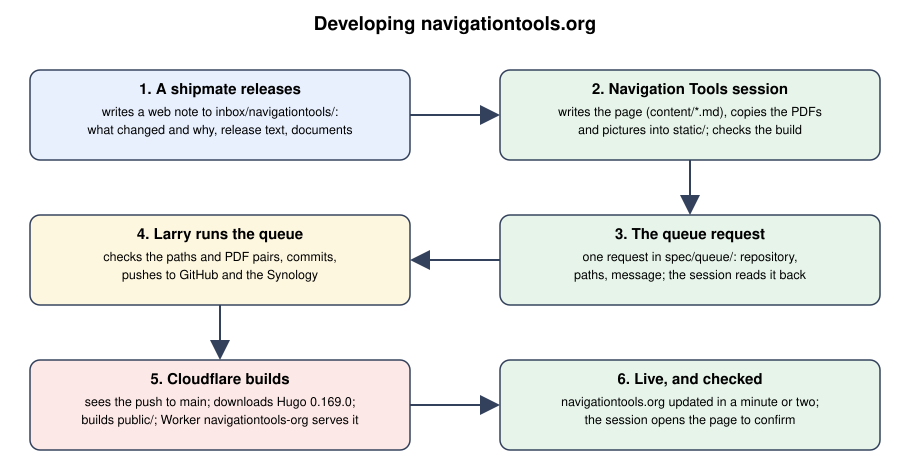
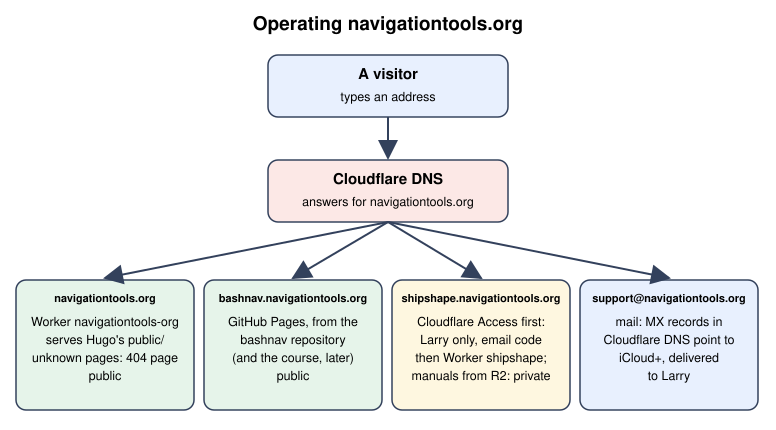

# navigationtools.org: how the site is developed and run

12 November 2026. The Navigation Tools session owns the site (`spec/handoffs/README.md`, "Who writes where", rule 4). Facts such as addresses and versions live in `spec/ENVIRONMENT.md`, section 4; this document shows how the pieces work together.

## 1. Developing the site

1. **Every change starts as a note.** A shipmate that releases something sends a web note; the Navigation Tools session is the only one that edits the site, so the site never has two authors pulling different ways.
2. **Nothing reaches the site except through the queue.** That is why step 4 is Larry's: the queue checks every path and every PDF pair, and builds the whole site with `tests/gate.sh`, before committing, so what is served is always what was committed and checked.
3. **Cloudflare builds from git, not from a laptop.** The build downloads the same Hugo version as on Larry's Mac (0.169.0), so the site looks the same in both places.
4. **The `public/` folder is built, never edited.** Cloudflare makes it fresh on every push.

## 2. Operating the site

1. **One DNS, four services.** Cloudflare answers for the domain and sends each address to the right place.
2. **Three are public and one is locked.** shipshape is behind Cloudflare Access, with Larry's email only; its manuals sit in a private R2 bucket reached only through the app.

## 3. When something goes wrong

1. **A build fails.** The last good version stays live, so visitors see nothing wrong. The failure and its log are in the Cloudflare dashboard, under **Workers & Pages → navigationtools-org**. Larry sends the log to the Navigation Tools session, which fixes it and queues the fix.
2. **A bad page went live.** Roll back in the same place (**Deployments**: choose an earlier version, **Rollback**), then fix it in git. The next push builds from `main` again, so a rollback alone is undone by the next change.
3. **The site does not answer.** Check Cloudflare's status page first, then the DNS records for the domain.
4. **Support mail stops arriving.** Check the MX records in Cloudflare's DNS against iCloud+'s custom-domain settings.
5. **After any change to shipshape's Access application,** repeat the signed-out check in `spec/ENVIRONMENT.md` section 4.4.5.

## 4. Still to confirm

1. **Where the domain is registered, and when it renews.**
2. **Who receives Cloudflare's email when a build fails.**

When both are known, they go into `spec/ENVIRONMENT.md` section 4, and this list is removed.
